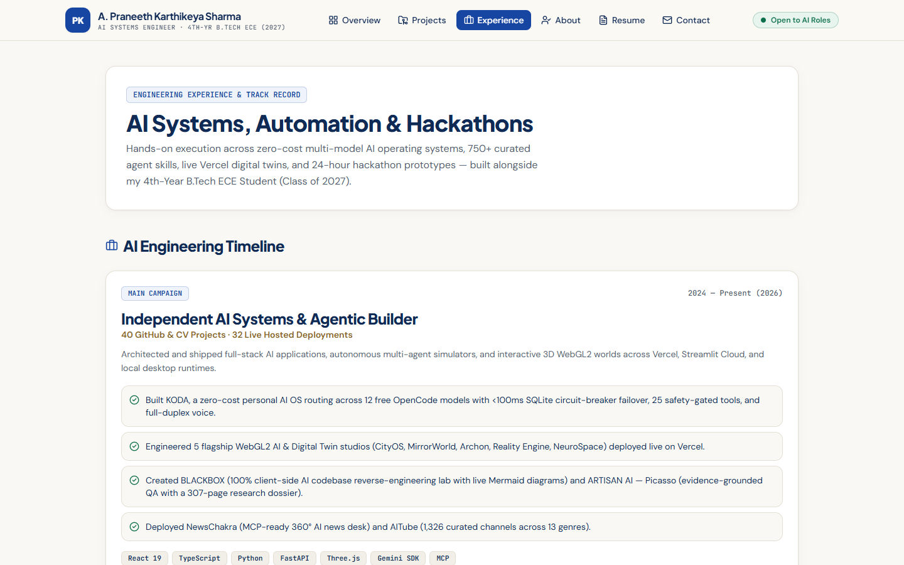
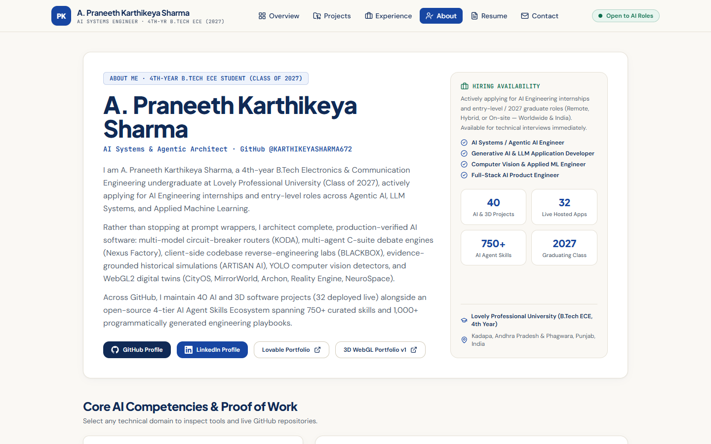
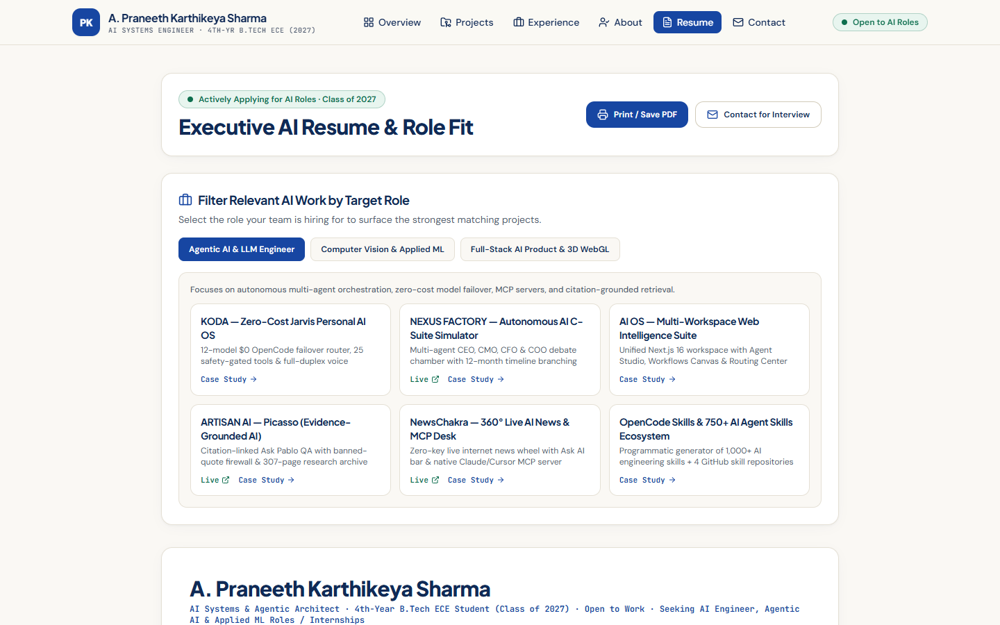
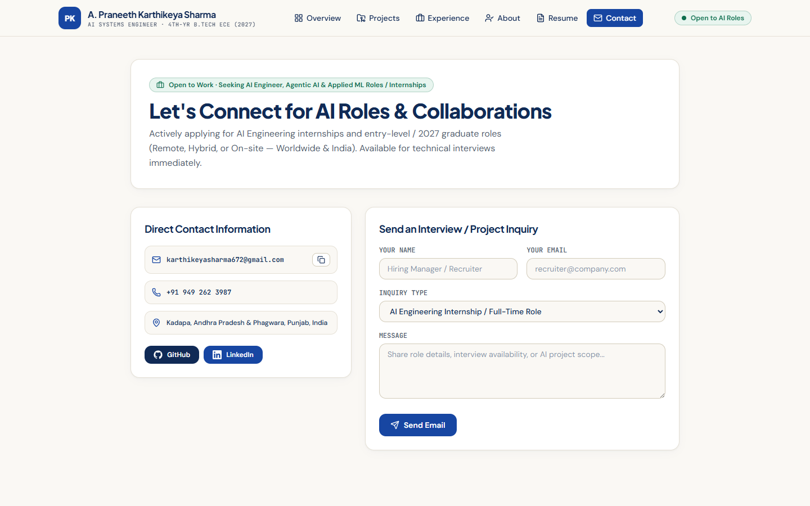

# 🚀 A. Praneeth Karthikeya Sharma — AI Systems Engineer Portfolio

> 🌐 **Live Production App:** [https://praneeth-ai-quest-portfolio.vercel.app](https://praneeth-ai-quest-portfolio.vercel.app)  
> 📦 **GitHub Repository:** [`KARTHIKEYASHARMA672/praneeth-ai-quest-portfolio`](https://github.com/KARTHIKEYASHARMA672/praneeth-ai-quest-portfolio)  
> 💼 **Hiring Status:** **Open to Work** — Actively applying for AI Engineering, Agentic AI, Applied ML & Full-Stack LLM Internships / Roles (4th-Year B.Tech ECE, Class of 2027).

> 🚀 **LinkedIn Publication Schedule:**
> - **Approval:** Yes
> - **Pushed to GitHub:** `2026-11-25`
> - **Scheduled LinkedIn Release:** `2026-11-26` at 23:00 IST (24h post-push showcase)
> - **Publication Status:** Pending

<!-- linkedin-automation: {"status": "approved", "pushed_date": "2026-11-25", "scheduled_date": "2026-11-26", "published": false} -->

---

## 📋 Project Properties

| Property | Value |
| :--- | :--- |
| **Author** | **A. Praneeth Karthikeya Sharma** (`KARTHIKEYASHARMA672`) |
| **Academic Standing** | 4th-Year B.Tech ECE — Lovely Professional University (Class of 2027) |
| **Live Production URL** | [https://praneeth-ai-quest-portfolio.vercel.app](https://praneeth-ai-quest-portfolio.vercel.app) |
| **GitHub Repository** | [`KARTHIKEYASHARMA672/praneeth-ai-quest-portfolio`](https://github.com/KARTHIKEYASHARMA672/praneeth-ai-quest-portfolio) |
| **Frontend Stack** | React 19 · TypeScript · Vite 8 · Tailwind CSS v4 · Three.js WebGL2 · React Router 7 |
| **Color System** | **Sapphire & Champagne** (`#1746A2` / `#FAF8F4` / `#102A56` / `#B88A3B` — `colours for websites` skill) |
| **Catalog Coverage** | **40 AI & 3D Software Projects** (`32` Live Hosted Apps + `8` Local/GitHub Source Systems, zero pure ECE hardware clutter) |
| **Verification** | `tsc -b` (0 errors) · `oxlint` (0 warnings/errors) · `vite build` · Playwright WebGL2 (0 console/page/HTTP errors) |

---

## 🧭 Quick Navigation

- [🖼️ Verified Visual UI Gallery](#-verified-visual-ui-gallery)
- [🗺️ Multi-Page Executive Architecture](#%EF%B8%8F-multi-page-executive-architecture)
- [🛠️ Local Development & Build](#%EF%B8%8F-local-development--build)

---

## 🖼️ Verified Visual UI Gallery

All 7 views below were rendered and verified in headless Chromium WebGL2 (`1440×900` desktop + `430×900` mobile responsive check, `0` console errors, `0` failed requests):

| View | Preview | Highlights |
| :--- | :---: | :--- |
| **01 — Executive Overview & Interactive 3D Studio (`/`)** |  | Recruiter-first hero highlighting job availability + an interactive Three.js WebGL2 Sapphire & Champagne 3D AI Systems Architecture sculpture with clickable domain nodes. |
| **02 — All GitHub & AI Projects (`/projects`)** |  | Searchable, filterable directory of **40 AI & 3D software projects** (`32` live hosted + `8` local/GitHub source), each with full descriptions, stack tags, and live/source links. |
| **03 — Case Study Dossier (`/projects/:slug`)** |  | Technical breakdown, system architecture summary, verified engineering highlights, hosted demo button, and GitHub repository link. |
| **04 — AI Engineering Experience (`/experience`)** |  | Engineering timeline covering autonomous systems, the 750+ GitHub AI Agent Skills Ecosystem, production AI pipelines, hackathons, and verified credentials. |
| **05 — About & Core Competencies (`/about`)** |  | 4th-Year B.Tech ECE profile, hiring availability, target roles, interactive AI Competency Matrix linked to proof-of-work projects, and academic timeline. |
| **06 — Executive AI Resume & Role Fit (`/resume`)** |  | Printable AI-focused CV (`Print / Save PDF`) paired with a Role-Based Project Matcher for hiring managers evaluating Agentic AI, Computer Vision, or Full-Stack AI roles. |
| **07 — Recruiter & Interview Contact (`/contact`)** |  | Availability banner, one-click email copy, GitHub/LinkedIn/phone links, and interview inquiry form. |

---

## 🗺️ Multi-Page Executive Architecture

- **`/` — Overview & 3D Studio:** Executive recruiter summary, Open-to-Work availability badge, KPI strip (`40` projects, `32` live hosted, `750+` AI skills, `2027` grad), and an interactive Three.js WebGL2 3D AI Systems Architecture sculpture.
- **`/projects` & `/projects/:slug` — 40 AI & 3D Projects:** Complete showcase across `Agentic AI & OS`, `3D Spatial AI & Twins`, `Computer Vision & ML`, `LLM & Knowledge AI`, `Developer & Workflow AI`, and `3D WebGL Worlds` — strictly AI/3D software with zero ECE hardware projects.
- **`/experience` — Engineering Track Record:** Production AI architectures (`KODA`, `ARTISAN AI`, `Milk Store Automation`, `YOLO + WebGL2`), 750+ AI skills ecosystem, and hackathons (`HackManthan 2025`, `LPU 24-Hour Hackathon`).
- **`/about` — About Me & Competency Matrix:** 4th-Year B.Tech ECE standing (Class of 2027, LPU), target AI roles, and interactive competency tabs mapped to GitHub repositories.
- **`/resume` — Executive Resume & Role Fit:** Print-ready AI CV + interactive Role-Fit project filter (`Agentic AI & LLM`, `Computer Vision & Applied ML`, `Full-Stack AI & 3D WebGL`).
- **`/contact` — Hiring & Collaboration:** Direct email, phone, GitHub, LinkedIn, and interview inquiry form.

---

## 🛠️ Local Development & Build

```bash
npm install
npm run dev      # Local development server
npm run lint     # Oxlint check (0 warnings / 0 errors)
npm run build    # TypeScript check + Vite 8 production bundle
```
