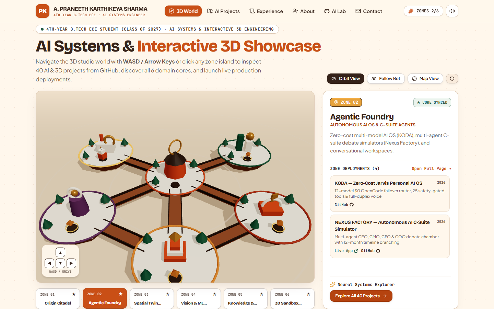
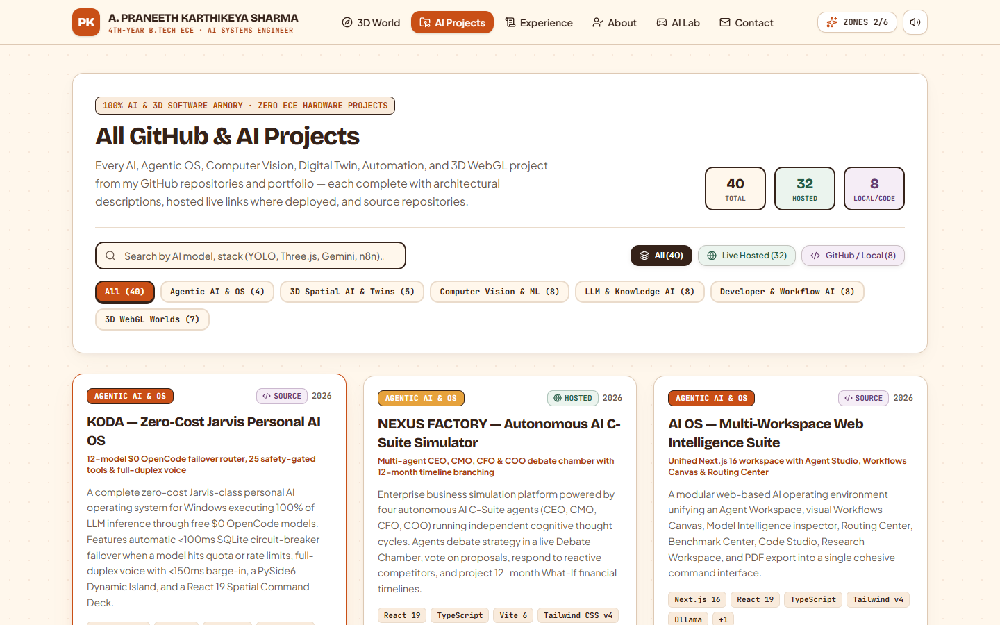
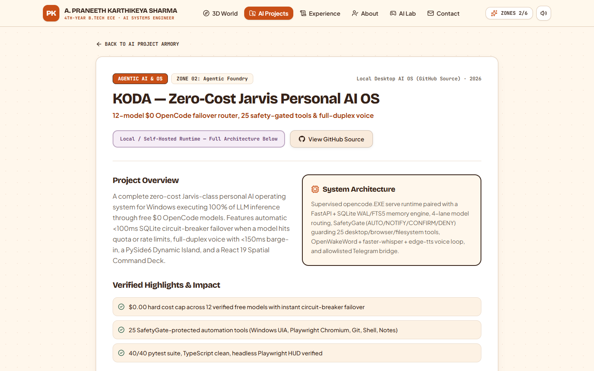

# 🚀 A. Praneeth Karthikeya Sharma — AI Systems & Interactive 3D Portfolio

> 🌐 **Live Production App:** [https://praneeth-ai-quest-portfolio.vercel.app](https://praneeth-ai-quest-portfolio.vercel.app)  
> 📦 **GitHub Repository:** [`KARTHIKEYASHARMA672/praneeth-ai-quest-portfolio`](https://github.com/KARTHIKEYASHARMA672/praneeth-ai-quest-portfolio)  
> 🎯 **Focus:** 100% Artificial Intelligence, Agentic Systems, Computer Vision, LLM Workflows & 3D WebGL Digital Twins *(zero pure ECE hardware clutter — built by a 4th-Year B.Tech ECE student, Class of 2027).*

> 🚀 **LinkedIn Publication Schedule:**
> - **Approval:** Yes
> - **Pushed to GitHub:** `2026-11-25`
> - **Scheduled LinkedIn Release:** `2026-11-26` at 23:00 IST (24h post-push showcase)
> - **Publication Status:** Pending

<!-- linkedin-automation: {"status": "approved", "pushed_date": "2026-11-25", "scheduled_date": "2026-11-26", "published": false} -->

---

## 📋 Project Properties

| Property | Value |
| :--- | :--- |
| **Author** | **A. Praneeth Karthikeya Sharma** (`KARTHIKEYASHARMA672`) |
| **Academic Standing** | 4th-Year B.Tech ECE — Lovely Professional University (Class of 2027) |
| **Live Production URL** | [https://praneeth-ai-quest-portfolio.vercel.app](https://praneeth-ai-quest-portfolio.vercel.app) |
| **GitHub Repository** | [`KARTHIKEYASHARMA672/praneeth-ai-quest-portfolio`](https://github.com/KARTHIKEYASHARMA672/praneeth-ai-quest-portfolio) |
| **Frontend Stack** | React 19 · TypeScript · Vite 8 · Tailwind CSS v4 · Three.js WebGL2 · React Router 7 |
| **Color System** | **Orange & Milk** (`#C94F16` / `#FFF7EC` / `#352219` / `#E6A23C` — `colours for websites` skill) |
| **Catalog Coverage** | **40 AI & 3D Projects** (`32` Live Hosted Apps + `8` Local/GitHub Source Systems) |
| **Verification** | `tsc -b` (0 errors) · `oxlint` (0 warnings/errors) · `vite build` · Playwright WebGL2 (0 console/page/HTTP errors) |

---

## 🧭 Quick Navigation

- [🖼️ Verified Visual UI Gallery](#-verified-visual-ui-gallery)
- [🗺️ Multi-Page & 3D Architecture](#%EF%B8%8F-multi-page--3d-architecture)
- [🤖 Highlighted AI Systems Showcased](#-highlighted-ai-systems-showcased)
- [🛠️ Local Development & Build](#%EF%B8%8F-local-development--build)

---

## 🖼️ Verified Visual UI Gallery

All 7 views below were rendered and verified in headless Chromium WebGL2 (`1440×900` desktop + `430×900` mobile responsive check, `0` console errors, `0` failed requests):

| View | Preview | Highlights |
| :--- | :---: | :--- |
| **01 — Interactive 3D World Overworld (`/`)** |  | Six interconnected Three.js WebGL2 islands, WASD/D-pad playable Explorer Bot, collectible zone cores, Orbit/Follow/Map camera modes, and live Zone Briefing drawer. |
| **02 — All GitHub & AI Projects (`/projects`)** |  | Searchable, filterable armory of **40 AI & 3D software projects** (`32` live hosted + `8` local/GitHub source), each with descriptions, stack tags, and direct links. |
| **03 — Mission Dossier (`/projects/:slug`)** |  | Deep architectural breakdown, verified highlights, tech stack, hosted demo button, and GitHub source link for every project. |
| **04 — AI Engineering Experience (`/experience`)** |  | Campaign timeline covering Agentic Systems, the 750+ GitHub AI Agent Skills Ecosystem, Computer Vision/n8n pipelines, and verified credentials/hackathons. |
| **05 — Executive Profile & AI Competencies (`/about`)** |  | 4th-Year B.Tech ECE identity card, interactive 5-branch AI Skill Tree with proof-of-work project links, academic timeline, and earlier portfolios. |
| **06 — Interactive AI Lab & Role Matcher (`/lab`)** |  | Playable multi-model failover router simulation (*Neural Router Runner*) plus a role-based AI project shortlist matcher. |
| **07 — Direct Contact & Collaboration (`/contact`)** |  | One-click email copy, direct GitHub/LinkedIn/phone links, and structured inquiry composer. |

---

## 🗺️ Multi-Page & 3D Architecture

- **`/` — 3D Interactive World:** Tactile Three.js WebGL2 diorama with 6 distinct zones (`Origin Citadel`, `Agentic Foundry`, `Spatial Twin Peaks`, `Vision & ML Outpost`, `Knowledge & Workflow Guild`, `3D Sandbox Arcade`), wooden bridges, animated architectural landmarks, and Web Audio feedback.
- **`/projects` & `/projects/:slug` — 40 AI & 3D Projects:** Complete showcase across `Agentic AI & OS`, `3D Spatial AI & Twins`, `Computer Vision & ML`, `LLM & Knowledge AI`, `Developer & Workflow AI`, and `3D WebGL Worlds` — strictly AI/3D software with zero ECE hardware projects.
- **`/experience` — AI Campaign Log:** Architecture pipelines (`KODA`, `ARTISAN AI`, `Milk Store Automation`, `YOLO + WebGL2`), 750+ AI skills ecosystem, and hackathons (`HackManthan 2025`, `LPU 24-Hour Hackathon`).
- **`/about` — Executive Profile & Skill Tree:** Highlighting 4th-Year B.Tech ECE standing (Class of 2027, LPU) with an interactive skill tree mapped directly to live GitHub builds.
- **`/lab` — Interactive AI Lab:** Playable 3-lane failover router simulation + role-based project matcher.
- **`/contact` — Direct Contact:** Email, phone, GitHub, LinkedIn, and inquiry form.

---

## 🛠️ Local Development & Build

```bash
npm install
npm run dev      # Local development server
npm run lint     # Oxlint check (0 warnings / 0 errors)
npm run build    # TypeScript check + Vite 8 production bundle
```
